# DiviGenre 사용 설명서

**소설**, **일반서**, **영화·드라마**, **만화**를 장르별 폴더로 정리하는 윈도우 앱이에요.

[최신 버전 받기](../../releases/latest) · [PDF 설명서](guide-ko.pdf) · [English](README.md)

| 종류 | 하는 일 |
|---|---|
| **소설** (.txt, .epub) | 본문을 읽고 `소설\판타지`, `소설\무협·동양풍` 같은 장르 폴더로 나눠요 |
| **일반서** (.txt, .epub, .pdf) | 대사가 거의 없는 책은 `일반서\경제·경영`, `일반서\과학` 같은 폴더로 나눠요 |
| **영화·드라마** (영상 파일) | TMDB에서 작품을 찾아 `영화\SF`, `드라마\리얼리티` 같은 폴더로 나눠요 |
| **만화** (압축 파일) | MangaUpdates에서 작품을 찾아 `만화\액션`, `만화\무협` 같은 폴더로 나눠요 |

- ✓ 옮기기만 해요. 지우거나 덮어쓰지 않아요.
- ✓ 언제든 되돌릴 수 있어요.
- ✓ 책, 영상, 만화가 섞인 폴더도 한 번에 정리해요.

지금 버전의 소설 장르는 **웹소설 위주**예요. 장르와 장르를 가려내는 단어는 설정에서 직접 더할 수 있어요.

---

## 1. 설치하기

1. [최신 버전](../../releases/latest)에서 `DiviGenre-Setup.exe`를 받아요.
2. 실행해요. "Windows의 PC 보호" 창이 뜨면 **추가 정보 → 실행**을 눌러요. (앱에 유료 서명이 없어서 뜨는 안내예요)
3. 끝이에요. 새 버전이 나오면 앱 위쪽에 파란 **새 버전** 버튼이 생겨요.

윈도우 10, 11 (64비트)

---

## 2. 정리하기

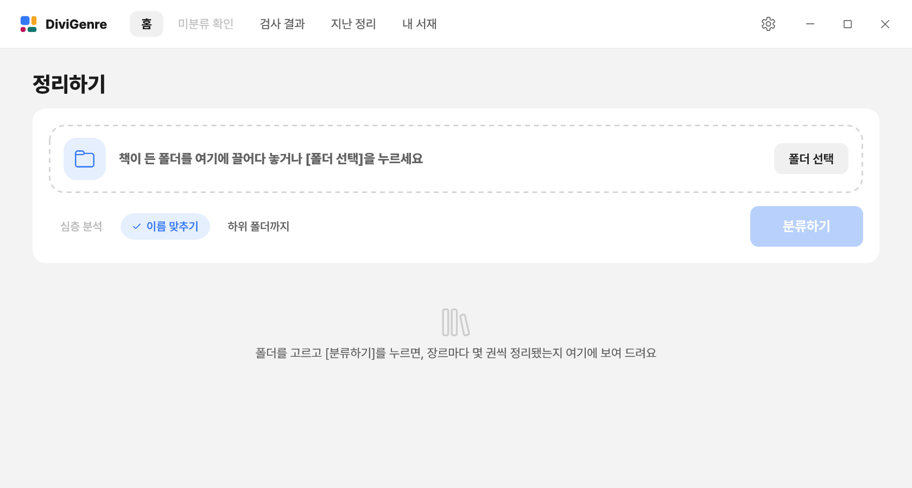

1. 정리할 폴더를 창에 끌어다 놓거나 **[폴더 선택]**을 눌러요.
2. 필요한 옵션을 켜요.

   | 옵션 | 하는 일 |
   |---|---|
   | 심층 분석 | 애매한 책을 AI가 읽고 판단 (설정에서 AI 연결 필요) |
   | 이름 맞추기 | 책 파일 이름을 깔끔하게 맞춰요 |
   | 하위 폴더까지 | 안쪽 폴더의 소설도 같이 정리해요 (대사가 거의 없는 글은 메모나 문서일 수 있어서 그 자리에 둬요) |

3. **[분류하기]**를 눌러요. 도서는 3장, 영상은 4장, 만화는 5장 방식으로 나뉘어요.

---

## 3. 도서 정리

> **예** `천마신교 귀환록 1-300.txt` → `소설\무협·동양풍\천마신교 귀환록 (1-300화).txt` (이름 맞추기 켬) · `돈이 일하게 하는 투자 습관.pdf` → `일반서\경제·경영\`

| 항목 | 설명 |
|---|---|
| 읽는 파일 | .txt, .epub, .pdf (PDF는 글자가 든 것만. 스캔한 그림 PDF는 미분류로 가요) |
| 나누는 법 | 본문에 자주 나오는 장르 단어(무림, 헌터, 게이트…)와 제목을 봐요 |
| 소설인지 일반서인지 | 대사(따옴표)가 많으면 소설, 거의 없으면 일반서로 보고 그쪽 장르 가운데서 골라요 |
| 소설 장르 | 웹소설 위주: 판타지, 무협·동양풍, 선협, 현대판타지(헌터·게임·스포츠·연예계·일반), 괴담·공포, 대체역사, 로맨스, 로맨스판타지, BL, SF |
| 일반서 장르 | 경제·경영, 자기계발, 인문·철학, 사회·정치, 역사, 과학, IT·컴퓨터, 건강·의학, 종교, 예술·문화, 여행·취미, 교육·어학, 에세이 |
| 예전 장르 폴더 | 예전 버전으로 정리한 `판타지` 같은 폴더는 다음 정리 때 `소설` 안으로 옮겨요. 이 옮기기는 지난 정리에서 따로 되돌릴 수 있어요 |
| 심층 분석 (선택) | 애매한 책은 AI가 책 다섯 군데를 읽고 판단해요 |
| 기억 | 직접 고른 장르는 제목으로 기억해서 다음에도 그 장르로 보내요 |
| 중복·옛 판본 | 최신 것만 남기고 나머지는 `확인 필요` 폴더로 옮겨요 |
| 이름 맞추기 (선택) | `[작가] 제목 1-224@xxx.txt` → `제목 (1-224화).txt` |
| 확신이 없으면 | `미분류` 폴더로 가요. 7장에서 직접 골라요 |

---

## 4. 영화·드라마 정리

> **예** `인터스텔라.2014.1080p.mkv` + 자막 → `영화\SF\` · `런닝맨\` (회차 파일들) → `드라마\리얼리티\런닝맨\`

| 항목 | 설명 |
|---|---|
| 읽는 파일 | .mp4 .mkv .avi .wmv .mov .m4v .ts .webm, 회차가 든 작품 폴더 |
| 나누는 법 | 파일 이름의 제목과 연도로 TMDB를 찾아 영화·드라마로 나눈 뒤 장르 폴더로 |
| 장르 | TMDB의 장르 이름 그대로. 맞는 장르가 없으면 `기타` |
| 함께 옮기는 것 | 자막(.srt .smi .ass .sub .vtt)은 영상과 같이, 회차 폴더는 통째로 |
| 확신이 없으면 | 영상 파일은 `미분류`로, 작품 폴더는 제자리에 둬요 |

**TMDB 무료 키**가 있어야 해요(9장). 키가 없으면 영상은 건드리지 않아요. TMDB에는 파일 이름에서 읽은 **제목과 연도만** 보내요.

---

## 5. 만화 정리

> **예** `원피스 01권.zip` → `만화\액션\` · `열혈강호\` (권 파일들) → `만화\무협\열혈강호\`

| 항목 | 설명 |
|---|---|
| 읽는 파일 | .cbz .cbr .cb7, 속이 그림인 .zip .rar .7z, 한 작품의 권 파일이 든 폴더 |
| 나누는 법 | 파일 이름의 제목으로 MangaUpdates를 찾아 그 작품의 장르 폴더로 |
| 장르 | 성인, BL, GL, 무협, 로맨스판타지, 스포츠, 액션, 공포, 스릴러, SF, 로맨스, 역사, 판타지, 개그, 일상, 드라마. 맞는 장르가 없으면 `기타` |
| AI (선택) | AI를 연결해 두면 MangaUpdates에서 못 찾은 제목은 AI에게도 물어봐요 |
| 확신이 없으면 | 만화 파일은 `미분류`로, 작품 폴더는 제자리에 둬요 |

키가 필요 없어요. 설정의 **만화** 탭에서 끌 수 있어요. 속이 그림이 아닌 압축 파일(소설 묶음 등)은 만화로 보지 않아요. MangaUpdates에는 **작품 제목만** 보내요(파일 이름에서 읽거나, 압축 파일 속 만화 정보 파일 ComicInfo.xml에 적힌 이름).

---

## 6. 결과 보기

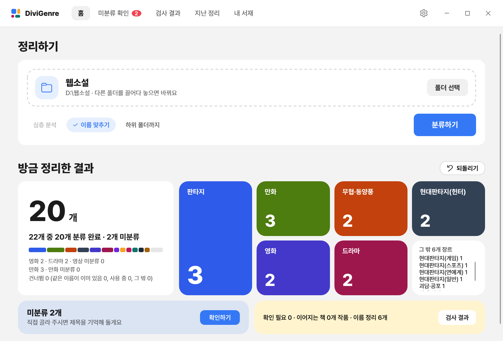

| 항목 | 설명 |
|---|---|
| 큰 숫자 | 장르 폴더로 간 책, 영상, 만화 수 |
| 색 타일 | 장르 하나에 타일 하나 (영화·드라마·만화 포함) |
| 미분류 N개 | 확신하지 못한 것 → **[확인하기]**로 직접 골라요 |
| 노란 칸 | 중복이나 옛 판본 알림 → **[검사 결과]**에서 자세히 |
| 검사 결과 탭 | 위쪽 메뉴에서 언제든 가장 최근 정리의 결과를 봐요. 위의 숫자와 장르 타일이 그대로 나오고, 그 아래에 중복·옛 판본·이름 정리가 나와요. 앱을 다시 켜서 고른 폴더가 없으면 그 정리의 폴더를 함께 골라 줘서, 미분류 확인을 바로 이어 할 수 있어요 |
| [되돌리기] | 방금 한 정리를 그대로 되돌려요 |

---

## 7. 미분류 확인

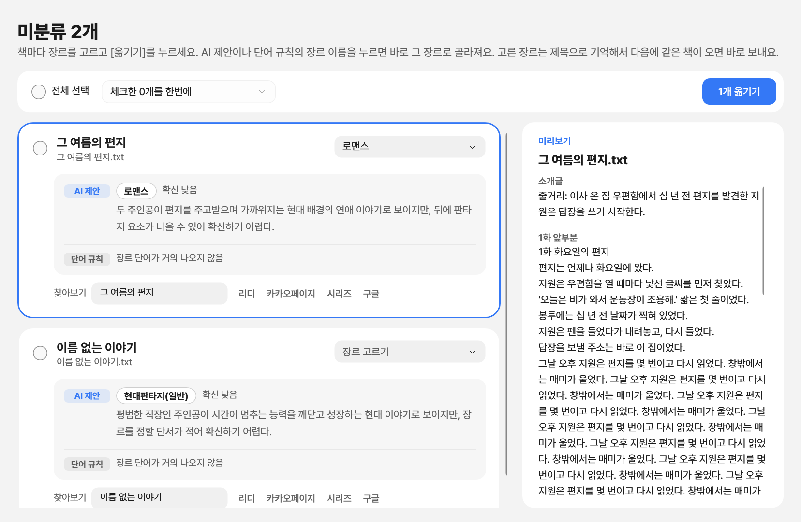

| 항목 | 설명 |
|---|---|
| 카드 | 책, 영상, 만화마다 한 장 |
| AI 제안 | AI가 고른 장르와 그 이유 (심층 분석을 켰을 때) |
| 단어 규칙 | 책에 많이 나온 단어로 짐작한 장르 |
| 영상 카드 | TMDB에서 찾은 후보 |
| 만화 카드 | MangaUpdates에서 찾은 후보. MangaUpdates·구글로 찾아볼 수 있어요 |
| 고르기 | 장르 이름을 누르거나 오른쪽 상자에서 골라요 |
| 미리보기 | 소개글과 1화 앞부분. 리디·카카오페이지·시리즈·구글로 찾아볼 수도 있어요 |
| 옮기기 | **[N개 옮기기]**. 책에 고른 장르는 제목으로 기억해요 |

---

## 8. 지난 정리 · 내 서재

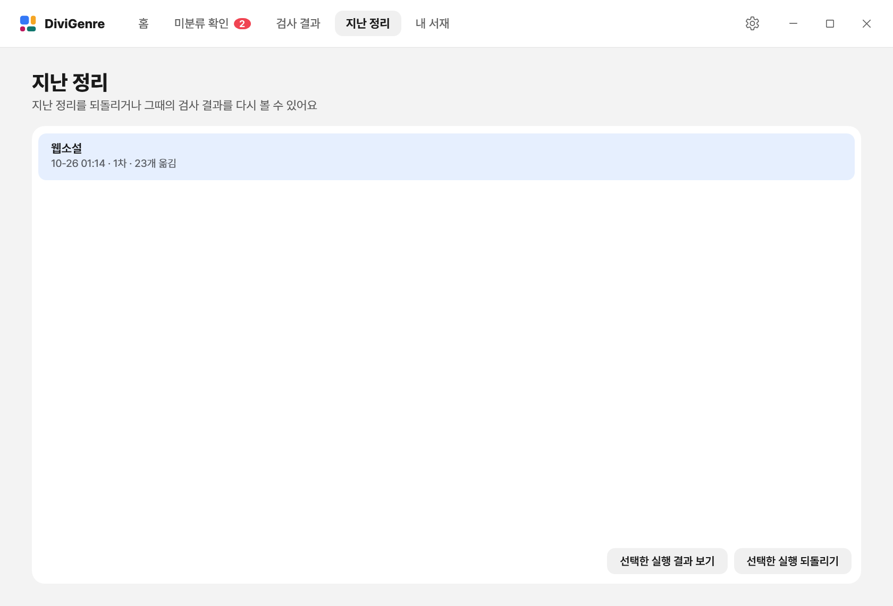

| 항목 | 설명 |
|---|---|
| 지난 정리 | 예전 정리를 다시 보거나 되돌려요 (최근 것부터). 정리를 골라 [선택한 실행 결과 보기]로 그때의 검사 결과도 봐요 |
| 내 서재 | 정리한 폴더 전체에서 제목을 찾아요. 책 파일을 끌어다 놓으면 이미 가진 책인지, 어느 쪽이 최신인지 알려 줘요 (옮기지 않아요) |

---

## 9. 설정

위쪽 오른편의 톱니바퀴 버튼으로 열어요. 탭은 **도서 장르 · 영화·드라마 장르 · 만화 · AI 연결 · TMDB**예요. **[저장]**을 눌러야 남고, **[취소]**나 Esc는 바꾼 것을 버려요.

### 9-1. 도서 장르

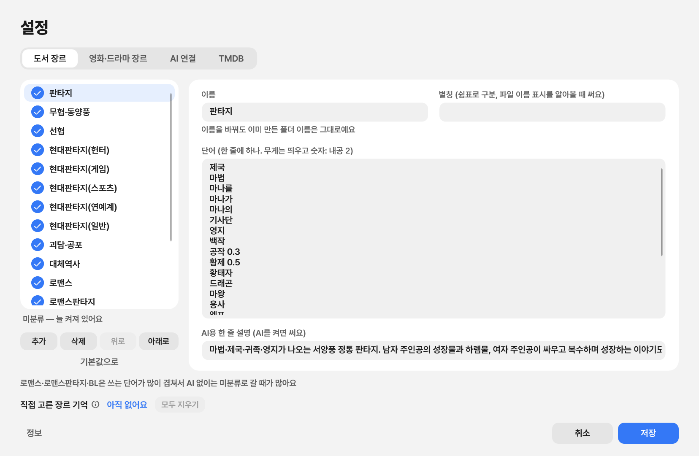

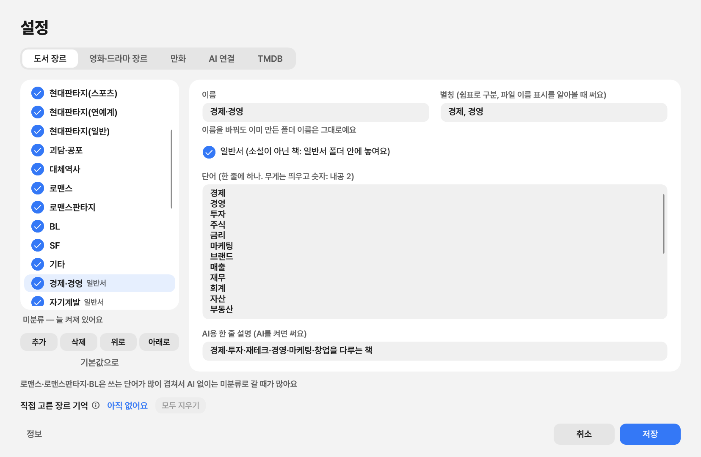

| 항목 | 설명 |
|---|---|
| 왼쪽 목록 | 체크로 켜고 끄기, [추가] [삭제] [위로] [아래로], [기본값으로] |
| 이름 | 장르 폴더 이름. 바꿔도 이미 만든 폴더는 그대로예요 |
| 별칭 | 파일 이름의 장르 표시를 알아볼 때 써요 (쉼표로 구분) |
| 단어 | 그 장르를 가려내는 단어. 한 줄에 하나, 중요한 단어는 `내공 2`처럼 무게를 줘요 |
| 일반서 | 체크하면 그 장르 폴더가 `일반서` 안에, 아니면 `소설` 안에 놓여요 |
| AI용 한 줄 설명 | 심층 분석 때 AI가 읽어요 |
| 장르 기억 | 직접 고른 장르 기억. [모두 지우기]로 잊어요. ⓘ에 마우스를 올리면 설명이 나와요 |

### 9-2. 단어가 다른 장르와 겹치면 알려 줘요

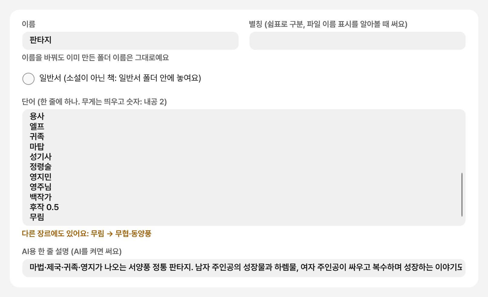

① 넣는 즉시 단어 상자 아래에 **"다른 장르에도 있어요"**가 떠요.

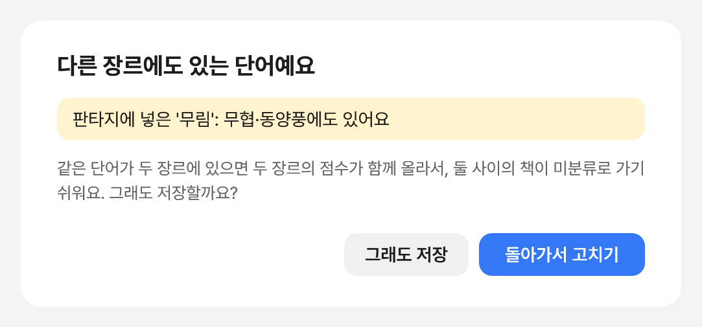

② 그대로 **[저장]**을 누르면 경고 창이 떠요. **[돌아가서 고치기]**는 그 장르로 돌아가고, **[그래도 저장]**은 그대로 저장해요.

같은 단어가 두 장르에 있으면 두 장르 점수가 함께 올라서 미분류로 가는 책이 늘어요. 원래부터 겹쳐 있던 단어(기본 장르끼리)는 알리지 않아요.

### 9-3. 영화·드라마 장르

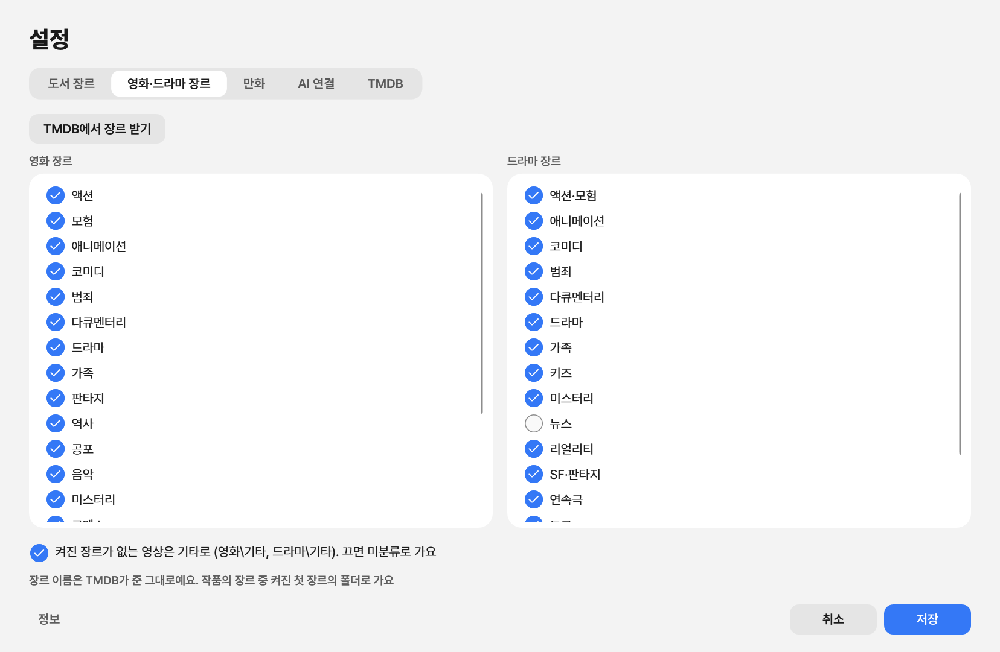

| 항목 | 설명 |
|---|---|
| 장르 받기 | [TMDB에서 장르 받기]로 목록을 받아요 (처음 정리할 때도 저절로) |
| 체크 | 안 쓸 장르는 꺼요. 작품의 장르 중 켜진 첫 장르의 폴더로 가요 |
| 기타로 | 끄면, 맞는 장르가 없는 영상은 미분류로 가요 |

### 9-4. 만화

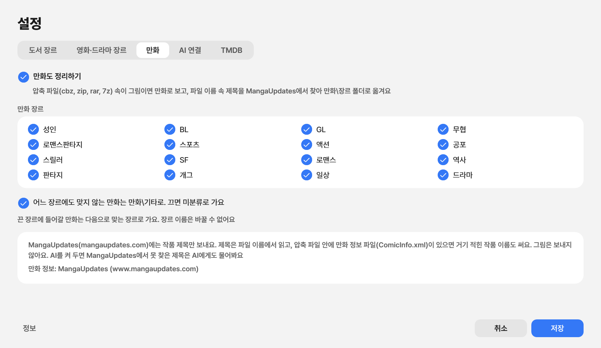

| 항목 | 설명 |
|---|---|
| 만화도 정리하기 | 끄면 압축 파일은 예전처럼 미분류로 가요 |
| 만화 장르 | 안 쓸 장르는 꺼요. 그 장르에 들어갈 만화는 다음으로 맞는 장르로 가요 |
| 기타로 | 끄면, 맞는 장르가 없는 만화는 미분류로 가요 |
| 보내는 것 | 작품 제목만 (파일 이름이나 ComicInfo.xml에서 읽은 것) |

### 9-5. AI 연결

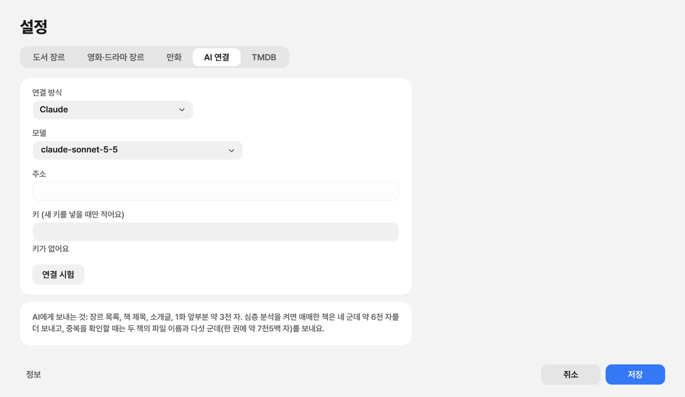

| 항목 | 설명 |
|---|---|
| 연결 방식 | 끔, Claude, Claude 구독(Claude Code), Gemini, OpenAI, 내 PC(Ollama · LM Studio), 직접 입력 |
| 모델 · 주소 · 키 | 채운 뒤 [연결 시험]으로 확인해요. 키는 새로 넣을 때만 적어요 |
| 키가 필요 없음 | Claude 구독, 내 PC의 모델 |
| 보내는 것 | 장르 목록, 책 제목, 소개글, 1화 앞부분 약 3천 자 (심층 분석 때 조금 더). 만화는 제목만 |

### 9-6. TMDB

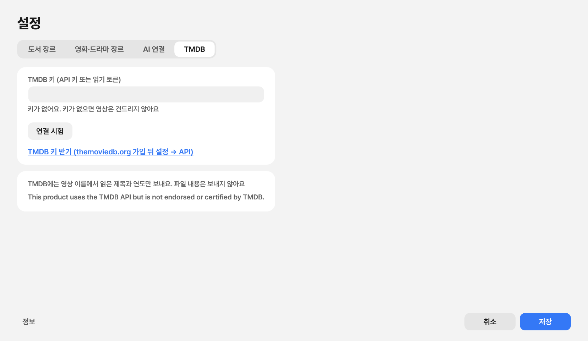

| 항목 | 설명 |
|---|---|
| 키 받기 | [themoviedb.org](https://www.themoviedb.org) 가입 → 설정 → API에서 무료로 |
| 확인 | [연결 시험] |
| 보내는 것 | 영상 이름에서 읽은 제목과 연도만 |

AI 키와 TMDB 키는 **이 PC에만** 윈도우 보안 기능으로 잠가 저장돼요.

---

## 자주 묻는 질문

**Q. 파일이 사라질 수도 있나요?**
아니요. 고른 폴더 안에서 옮기기만 해요. 같은 이름의 파일이 있으면 건너뛰고 알려 줘요.

**Q. 정리를 잘못했어요.**
홈의 **[되돌리기]**나 **지난 정리**에서 되돌리면 원래 자리, 원래 이름으로 돌아가요.

**Q. 웹소설이 아닌 책도 되나요?**
네. 대사가 거의 없는 책(경제, 역사, 과학 같은 일반서)은 `일반서` 폴더로 가요. .txt, .epub, .pdf를 읽어요.

**Q. 예전에 정리한 폴더 모양이 바뀌나요?**
네. 장르 폴더가 `소설`과 `일반서` 안으로 들어가요. 예전 장르 폴더는 다음 정리 때 `소설` 안으로 옮기고, 이 옮기기는 지난 정리에서 따로 되돌릴 수 있어요.

**Q. 영상만 있는 폴더도 되나요?**
네. TMDB 키만 있으면 돼요.

**Q. 만화는 어떤 파일이 되나요?**
압축 파일(cbz, zip, rar, 7z)이면 돼요. 압축하지 않은 그림 폴더나 PDF는 아직 다루지 않아요.

**Q. 인터넷이 필요한가요?**
도서 정리에는 필요 없어요. AI 분석, 영화·드라마 정리, 만화 정리, 업데이트 확인에만 써요. 업데이트 확인 때는 책이나 영상 정보를 보내지 않아요.

---

글꼴: Pretendard (SIL Open Font License 1.1) · 영화·드라마 정보: TMDB (This product uses the TMDB API but is not endorsed or certified by TMDB.) · 만화 정보: MangaUpdates (www.mangaupdates.com) · PDF 읽기: PdfPig (Apache License 2.0) · 앱에 든 오픈 소스 소프트웨어의 사용 조건은 설정 → 정보 → 오픈 소스 알림에 있어요.
