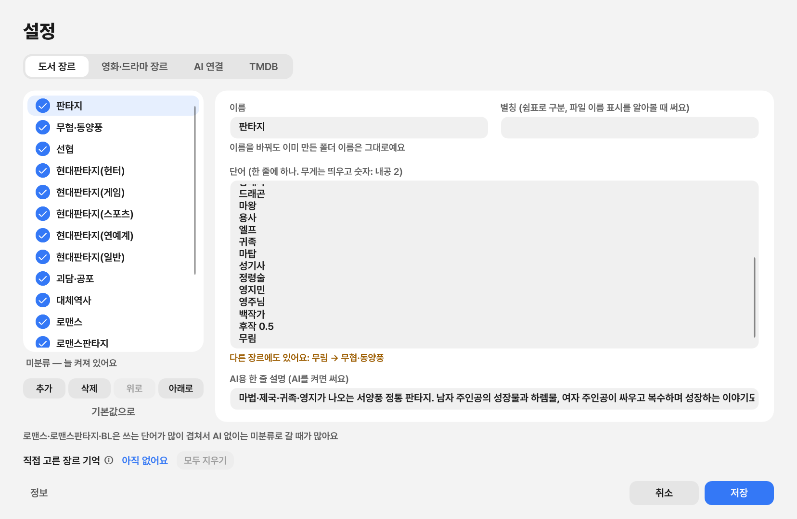

# DiviGenre 사용 설명서

DiviGenre는 **도서**와 **영화·드라마**를 장르별 폴더로 정리해 주는 윈도우 앱이에요.

- **도서**(`.txt`, `.epub`): 본문을 읽고 판타지, 무협·동양풍, 로맨스판타지 같은 장르 폴더로 나눠요.
- **영화·드라마**(영상 파일): TMDB에서 작품을 찾아 `영화\SF`, `드라마\리얼리티` 같은 장르 폴더로 나눠요.

지금 버전의 도서 장르는 **웹소설 위주**로 짜여 있어요. 원하면 설정에서 **장르와 장르를 가려내는 단어를 직접 더할 수 있어요.**

책과 영상이 섞인 폴더도 한 번에 정리해요. 파일은 고른 폴더 안에서 **옮기기만** 하고, 지우거나 덮어쓰지 않아요. 정리한 것은 언제든 되돌릴 수 있어요.

[English](README.md) · [PDF 설명서](guide-ko.pdf)

## 1. 설치

1. [최신 버전](../../releases/latest)에서 `DiviGenre-Setup.exe`를 받아 실행해요.
2. "Windows의 PC 보호" 창이 뜨면 **추가 정보 → 실행**을 눌러요. 앱에 유료 서명이 없어서 뜨는 안내예요.
3. 그다음부터는 앱이 알아서 업데이트돼요. 새 버전이 나오면 위쪽에 파란 **새 버전** 버튼이 생겨요.

윈도우 10, 11(64비트)에서 돌아가요.

## 2. 정리하기

1. 정리할 폴더를 창에 끌어다 놓거나 **[폴더 선택]**을 눌러요.
2. 필요한 옵션을 켜요.
   - **심층 분석**: 규칙으로 애매한 책을 AI가 읽고 판단해요. 설정에서 AI를 연결해야 켤 수 있어요.
   - **이름 맞추기**: 책 파일 이름을 깔끔하게 맞춰요.
   - **하위 폴더까지**: 안쪽 폴더의 책도 같이 정리해요.
3. **[분류하기]**를 눌러요. 폴더 안의 도서와 영상이 각각 아래 3장, 4장 방식으로 나뉘어요.

## 3. 도서 정리

- `.txt`, `.epub` 파일을 읽어요.
- 본문에 많이 나오는 장르 단어(무림, 헌터, 게이트, 영애…)를 세고 제목도 읽어서 장르를 정해요. 이름이 제목뿐인 파일도 맞는 폴더로 가요.
- 기본 장르는 지금 웹소설에 맞춰져 있어요: 판타지, 무협·동양풍, 선협, 현대판타지(헌터·게임·스포츠·연예계·일반), 괴담·공포, 대체역사, 로맨스, 로맨스판타지, BL, SF. **설정 → 도서 장르**에서 장르를 더하거나 이름, 단어, AI용 설명을 바꿀 수 있어요. 넣은 단어가 다른 장르와 겹치면 알려 줘요(8장).
- **심층 분석**(선택): 규칙으로 애매한 책은 고른 AI가 1화만이 아니라 책 다섯 군데를 읽고 판단해요.
- **직접 고른 장르는 기억해요.** 미분류 확인에서 고른 장르는 제목으로 기억해서, 다음에 같은 제목이 오면 어느 폴더에서든 그 장르로 보내요.
- **중복과 옛 판본을 찾아요.** 같은 작품이 두 파일로 있거나 `1-200화` 옆에 `1-400화`가 있으면 최신 것만 남기고, 나머지는 `확인 필요` 폴더로 옮겨요.
- **이름 맞추기**(선택): `[작가] 제목 1-224@xxx.txt` 같은 이름을 `제목 (1-224화).txt`로 바꿔요.
- 장르를 확신하지 못한 책은 `미분류` 폴더로 가요.

## 4. 영화·드라마 정리

- 영상 파일(`.mp4`, `.mkv`, `.avi`, `.wmv`, `.mov`, `.m4v`, `.ts`, `.webm`)과 회차가 든 작품 폴더를 읽어요.
- 파일 이름에서 제목과 연도를 읽어 TMDB(세계 영화·드라마 정보 사이트)에서 찾고, **영화**와 **드라마**로 나눈 뒤 그 안의 장르 폴더로 옮겨요.
  - `인터스텔라.2014.1080p.mkv` → `영화\SF`
  - `런닝맨` 폴더(회차 파일들) → `드라마\리얼리티`
- 장르는 TMDB가 정한 이름을 그대로 써요. **설정 → 영화·드라마 장르**에서 쓰지 않을 장르를 끌 수 있어요. 켜진 장르가 하나도 맞지 않으면 `기타` 폴더로 가요.
- **함께 옮겨요.** 자막(`.srt`, `.smi`, `.ass`, `.sub`, `.vtt`)은 영상과 같이, 회차가 든 폴더는 폴더째 옮겨요.
- TMDB에서 확실히 찾지 못한 영상 파일은 `미분류` 폴더로 가요. 확실하지 않은 작품 폴더는 제자리에 둬요.
- 쓰려면 TMDB 무료 키가 필요해요(**설정 → TMDB**). 키가 없으면 영상은 건드리지 않아요.
- TMDB에는 파일 이름에서 읽은 제목과 연도만 보내요. 파일 내용은 보내지 않아요.

## 5. 결과 보기

- 큰 숫자는 장르 폴더로 간 책과 영상 수예요. 색 타일 하나가 장르 하나이고, 영화와 드라마도 타일로 나와요.
- **미분류 N개**: 앱이 확신하지 못한 책과 영상이에요. **[확인하기]**로 직접 골라 주세요.
- 노란 칸: 같은 작품이 두 개 있거나 옛 판본이 있으면 알려 줘요. **[검사 결과]**에서 자세히 볼 수 있어요.
- **[되돌리기]**: 방금 한 정리를 그대로 되돌려요.

## 6. 미분류 확인

- 책과 영상마다 카드 한 장이에요.
- 도서 카드
  - **AI 제안**: AI가 고른 장르와 그 이유예요. 심층 분석을 켰을 때만 나와요.
  - **단어 규칙**: 책에 많이 나온 단어로 짐작한 장르예요.
  - 오른쪽 미리보기에서 소개글과 1화 앞부분을 볼 수 있어요.
  - 리디·카카오페이지·시리즈·구글 버튼으로 그 책의 장르를 찾아볼 수 있어요.
- 영상 카드: TMDB에서 찾은 후보가 나와요.
- 장르 이름을 누르면 바로 그 장르가 골라져요. 오른쪽 상자에서 직접 골라도 돼요.
- 다 고르면 **[N개 옮기기]**를 눌러요.

## 7. 지난 정리, 내 서재

- **지난 정리**: 예전에 한 정리를 다시 보거나 되돌려요. 되돌리기는 최근 것부터 해요.
- **내 서재**: 정리한 폴더 전체에서 제목을 찾아요. 책 파일을 끌어다 놓으면 이미 가진 책인지, 어느 쪽이 더 최신인지 알려 줘요. 끌어다 놓은 파일은 옮기지 않아요.

## 8. 설정

위쪽 오른편의 톱니바퀴 버튼으로 열어요. 탭은 **도서 장르**, **영화·드라마 장르**, **AI 연결**, **TMDB** 네 개예요. 바꾼 것은 **[저장]**을 눌러야 남고, **[취소]**나 Esc를 누르면 버려요. 왼쪽 아래 **[정보]**에서 버전을 볼 수 있어요.

### 도서 장르

그림은 3장에 있어요.

- **왼쪽 목록**: 체크를 끄면 그 장르는 쓰지 않아요. **[추가]**로 새 장르를 만들고, **[삭제]**로 지우고, **[위로]**·**[아래로]**로 순서를 바꿔요. **[기본값으로]**는 처음 장르로 되돌려요.
- **이름**: 장르 폴더 이름이 돼요. 이름을 바꿔도 이미 만든 폴더 이름은 그대로예요.
- **단어**: 그 장르를 가려내는 단어를 한 줄에 하나씩 써요. 더 중요한 단어는 띄우고 숫자를 붙여 무게를 줘요(예: `내공 2`). 숫자가 없으면 무게 1이에요.
- **별칭**: 쉼표로 구분해요. 파일 이름에 붙은 장르 표시를 알아볼 때 써요.
- **AI용 한 줄 설명**: 심층 분석 때 AI가 이 설명을 보고 장르를 골라요.
- **직접 고른 장르 기억**: 미분류 확인에서 직접 고른 제목들이에요. **[모두 지우기]**로 잊게 할 수 있어요. 이름 옆 ⓘ에 마우스를 올리면 설명이 나와요.

### 단어가 다른 장르와 겹치면 알려 줘요

새로 넣은 단어가 다른 장르에도 있으면, 단어 상자 바로 아래에 **"다른 장르에도 있어요"**라고 떠요.

그대로 **[저장]**을 누르면 경고 창이 떠요. 같은 단어가 두 장르에 있으면 두 장르의 점수가 함께 올라서, 둘 사이의 책이 미분류로 가기 쉽기 때문이에요.

- **[돌아가서 고치기]**: 그 단어를 넣은 장르로 돌아가요.
- **[그래도 저장]**: 그대로 저장해요.
- 원래부터 겹쳐 있던 단어(기본 장르끼리 겹치는 단어)는 알리지 않아요. 직접 넣은 단어만 봐요.

### 영화·드라마 장르

그림은 4장에 있어요.

- **[TMDB에서 장르 받기]**로 TMDB의 영화·드라마 장르 목록을 받아요. 처음 영상을 정리할 때도 저절로 받아요.
- 쓰지 않을 장르는 체크를 꺼요. 작품의 장르 중 켜진 첫 장르의 폴더로 가요.
- **켜진 장르가 없는 영상은 기타로**: 끄면 그런 영상은 미분류로 가요.

### AI 연결

- **연결 방식**: 끔, Claude, Claude 구독(Claude Code), Gemini, OpenAI, 내 PC(Ollama), 내 PC(LM Studio), 직접 입력 중에서 골라요.
- **모델**, **주소**(내 PC나 직접 입력일 때만), **키**(새 키를 넣을 때만 적어요)를 채우고 **[연결 시험]**으로 바로 확인해요.
- Claude 구독은 이 PC의 Claude Code에 로그인한 구독으로 물어서 키가 필요 없어요. 내 PC의 모델도 키가 필요 없어요.
- 아래 칸에 AI에게 보내는 것이 적혀 있어요. 장르 목록, 책 제목, 소개글, 1화 앞부분 약 3천 자예요. 심층 분석을 켜면 애매한 책은 몇 군데를 더 보내요.

### TMDB

- [themoviedb.org](https://www.themoviedb.org)에 가입한 뒤 설정 → API에서 무료 키(API 키나 읽기 토큰)를 받아 넣어요.
- **[연결 시험]**으로 확인해요. 키가 없으면 영상은 건드리지 않아요.
- TMDB에는 영상 이름에서 읽은 제목과 연도만 보내요.

AI 키와 TMDB 키는 이 PC에만 윈도우 보안 기능으로 잠가 저장돼요.

## 자주 묻는 질문

**파일이 사라질 수도 있나요?**
아니요. 고른 폴더 안에서 옮기기만 해요. 같은 이름의 파일이 이미 있으면 건너뛰고 알려 줘요.

**정리를 잘못했어요.**
홈의 **[되돌리기]**나 **지난 정리**에서 되돌리면 원래 자리, 원래 이름으로 돌아가요.

**웹소설이 아닌 책도 되나요?**
네. `.txt`, `.epub`이면 돼요. 다만 기본 장르와 단어가 웹소설에 맞춰져 있어서, 다른 책은 **설정 → 도서 장르**에서 장르를 더해 주면 더 잘 나눠요.

**영상만 있는 폴더도 되나요?**
네. TMDB 키만 넣으면 책 없이 영상만 있는 폴더도 정리해요.

**인터넷이 필요한가요?**
도서 정리에는 필요 없어요. AI 분석, 영화·드라마 정리, 업데이트 확인에만 인터넷을 써요. 업데이트 확인 때는 책이나 영상에 대한 정보를 보내지 않아요.

---

글꼴: Pretendard (SIL Open Font License 1.1) · 영화·드라마 정보: TMDB (This product uses the TMDB API but is not endorsed or certified by TMDB.)
