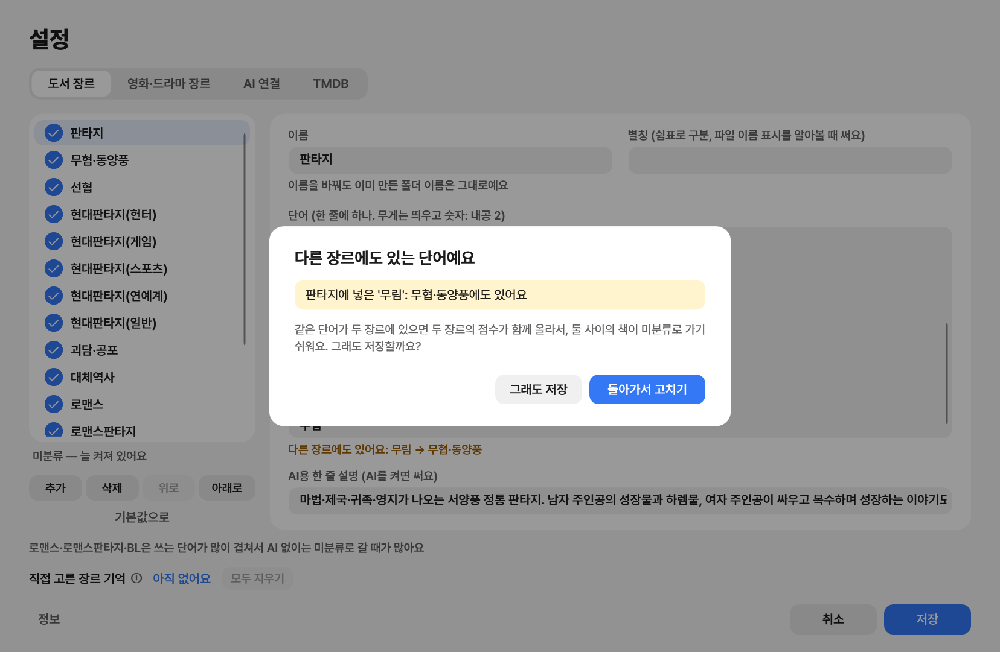

# DiviGenre

**Sort your books and your movies and TV shows into genre folders — safely, and with one-click undo.**

[한국어 설명서](README.ko.md) · [Korean guide as PDF](guide-ko.pdf)

DiviGenre is a Windows app for anyone with a big folder of books, videos, or both:

- **Books** (`.txt`, `.epub`): it reads each book and moves it into a genre folder such as 판타지, 무협·동양풍 or 로맨스판타지.
- **Movies and TV shows** (video files): it finds each title on TMDB and moves it into a genre folder under 영화 (movies) or 드라마 (TV shows), such as `영화\SF` or `드라마\리얼리티`.

In this version the book genres are made for **Korean web novels**. You can **add your own genres, and the words that pick them out**, in the settings.

Drop the folder on the window and both are sorted in one go. Whatever it is not sure about waits in 미분류 for you to decide.

The name is *Divi* + *Genre*: say it fast and you hear *division*.

## What it does

### Books

- **The genres it comes with are made for Korean web novels** (판타지, 무협·동양풍, 선협, 현대판타지, 괴담·공포, 대체역사, 로맨스, 로맨스판타지, BL, SF). Add your own, or change any genre's name, words and AI description.

- **Sorts by reading the books.** It counts genre words in each book (무림, 헌터, 게이트, 영애…) and reads the title, so a file named only by its title still lands in the right folder.
- **Asks an AI when you want it to (optional).** With 심층 분석 on, the books the word rules are unsure of are shown to an AI you choose — Claude, Gemini, OpenAI, or a model running on your own PC. It reads five places in the book, not just chapter 1.
- **Remembers your choices.** A title you sorted by hand goes to the same genre next time, from any folder.
- **Finds copies and older versions.** The same work in two files, or 1–200화 next to 1–400화: the newest stays, the others wait in 확인 필요.
- **Tidies file names** (optional): `[작가] 제목 1-224@xxx.txt` becomes `제목 (1-224화).txt`.

### Movies and TV shows

- **Finds each title on TMDB.** It reads the title and year from the file name (`Interstellar.2014.1080p.mkv`), looks it up on TMDB, and moves it into that title's genre folder under 영화 or 드라마.
- **Keeps things together.** Subtitles (`.srt`, `.smi`, `.ass`, `.sub`, `.vtt`) move with their video, and a folder of episodes moves as a whole.
- **Uses TMDB's genres**, in Korean. Switch off the ones you don't want; a title none of your genres fit goes to 기타 (other).
- **Asks when unsure.** A video file TMDB cannot match with confidence waits in 미분류 with TMDB's candidates; an uncertain folder stays where it is.
- Needs your own free TMDB key. Without one, videos are left alone. Only the title and year read from the file name are sent to TMDB.

Reads `.mp4`, `.mkv`, `.avi`, `.wmv`, `.mov`, `.m4v`, `.ts` and `.webm`.

### Both

- **Lets you decide the hard ones.** 미분류 확인 shows each unsure book or video as a card: what the AI proposed and why, what the word rules guessed and from which words, TMDB's candidates for a video, a preview of the book, and links to look it up on Ridi, KakaoPage, Naver Series or Google. Pick a genre with one click.
- **Searches your library.** Look up a title across every folder you sorted, or drop a file to see whether you already have it, and which copy is newer.

## Settings

Open them with the gear at the top right. Nothing changes until you press 저장 (save); 취소 (cancel) or Esc drops the edits.

- **도서 장르 (book genres)**: switch genres on or off, add, delete, reorder, or go back to the defaults. Each genre has a name (its folder), its words (one per line; `내공 2` gives a word twice the weight), aliases, and a one-line description the AI reads.
- **Shared words are flagged.** A word you type that another genre already has shows up under the box at once, and saving asks first: a word in two genres raises both scores, so books between them more often end in 미분류. Words the genres shared to begin with are left alone.
- **영화·드라마 장르 (movie and show genres)**: TMDB's genres, each one can be switched off. A title none of them fit goes to 기타, or to 미분류 if you switch that off.
- **AI 연결 (AI connection)**: off, Claude, a Claude plan through Claude Code, Gemini, OpenAI, Ollama or LM Studio on your PC, or a server of your own; a connection test; the page says exactly what is sent.
- **TMDB**: your free key and a connection test.

## Safe by design

- Files are only **moved** inside the folder you chose. Nothing is ever deleted or overwritten.
- Every run is written down, so **runs can be undone** from 지난 정리, newest first.
- Your AI and TMDB keys stay on your PC, protected by Windows (DPAPI). The AI and TMDB are only used when you turn them on, and the settings say exactly what is sent.
- When it starts, the app asks GitHub whether a newer version exists. Nothing about your books or videos is sent.

## Install

1. Download `DiviGenre-Setup.exe` from the [latest release](../../releases/latest).
2. Run it. Windows may show "Windows protected your PC" because the app is not code-signed: choose **More info → Run anyway**.
3. The app updates itself: when a new version is out, a blue **새 버전** button appears at the top.

Windows 10 or 11, 64-bit. The app's screens are in Korean.

## Credits

- Font: [Pretendard](https://github.com/orioncactus/pretendard) by Kil Hyung-jin, SIL Open Font License 1.1.
- Movie and show data: this product uses the TMDB API but is not endorsed or certified by TMDB.
- Updates: [Velopack](https://velopack.io) (MIT).

Free to use. This repository holds the releases and the guide; the source code is not published here.
